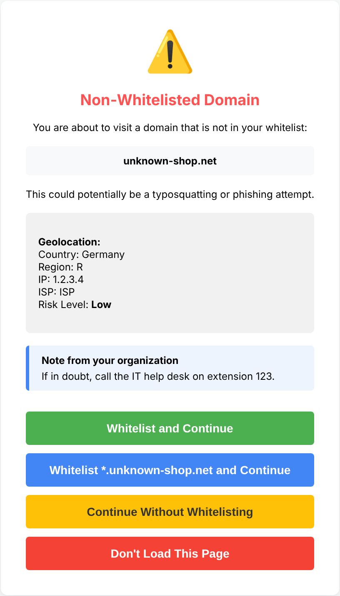
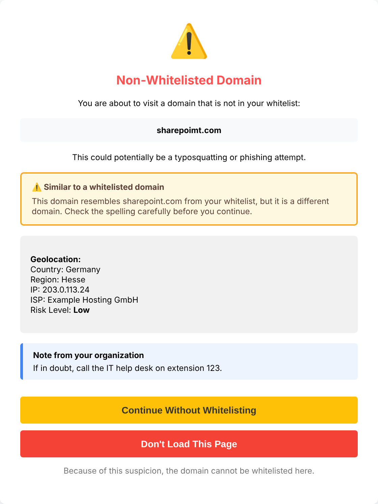
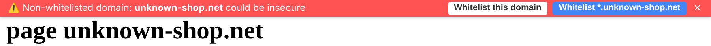
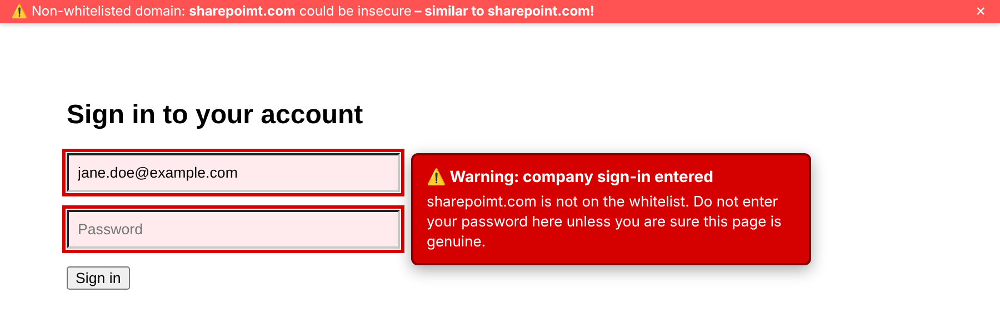
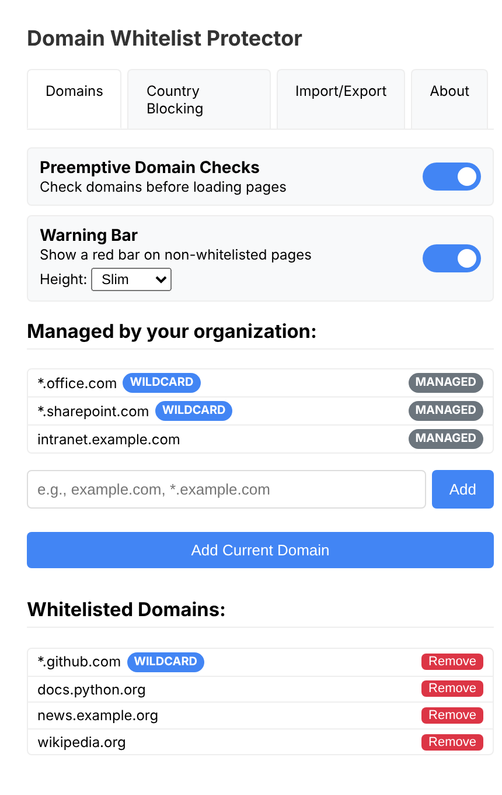

# Domain Whitelist Protector


A browser extension for Chrome and Edge that protects against typosquatting and
phishing. It warns before a domain loads that is not on your whitelist, and it
can be rolled out and configured centrally through Group Policy.

## Features

**Protection**

- **Confirmation page**: non-whitelisted domains are intercepted before they load; you choose to continue once, whitelist, or leave
- **Warning bar**: a red banner on non-whitelisted pages; closing it hides it for that website until the tab is closed, and it can be turned off entirely
- **Lookalike detection**: warns when a domain imitates a whitelisted one, using characters from other alphabets (`аmazon.de` with a Cyrillic "а"), typos (`sharepoimt.com`), visual tricks (`rnicrosoft.com`), other endings (`sharepoint.co`) or the trusted name as a subdomain (`sharepoint.com.evil.net`). Such domains cannot be whitelisted with one click
- **Sign-in guard**: marks the field red and warns when a company e-mail address is typed on a non-whitelisted page
- **Country blocking**: optionally looks up where a non-whitelisted domain is hosted and blocks selected countries

**Whitelist management**

- Exact domains and wildcards (`*.example.com`)
- Allow a domain permanently or only for the current browser session
- Clean-up hint for entries that other entries already cover
- Import and export

**For organizations**

- Central whitelist through Group Policy that users cannot remove
- Settings can be locked; an optional note (for example the help desk number) appears on the confirmation page
- Self-hosted rollout with generated policy templates (ADMX/ADML)

The interface is available in English and German and follows the browser language.

## Screenshots

| Confirmation page | Lookalike warning |
| --- | --- |
|  |  |

| Warning bar and sign-in guard | Popup |
| --- | --- |
|   |  |

## How it works

1. When a page starts to load, the extension checks its domain against the organization whitelist and your own whitelist.
2. Whitelisted domains load as usual.
3. For any other domain a confirmation page appears. It shows the domain, any lookalike warning, the hosting country (if enabled) and the note from your organization.
4. You can continue without whitelisting (remembered until the browser closes), whitelist the domain or `*.domain`, or not load the page.
5. On non-whitelisted pages the warning bar stays visible and the sign-in guard watches the input fields.

The similarity and lookalike checks compare the domain with your whitelist inside the browser. They are hints, not proof: `bahn.com` is reported as similar to `bahn.de`, for example.

## Requirements

- Google Chrome or Microsoft Edge, version 153 or later
- [Node.js](https://nodejs.org/) only for building packages

A Firefox package is still built from `src/manifest.firefox.json`, but it has not been tested with the current version and is not covered by the enterprise rollout.

## Installation

### For testing (unpacked)

1. Download or clone this repository
2. Open `chrome://extensions/` (Edge: `edge://extensions/`)
3. Enable "Developer mode"
4. Click "Load unpacked" and select the `src/` directory

### For an organization

The extension is self-hosted and force-installed through Group Policy:

```bash
node scripts/enterprise.js --url https://intranet.example.com/extensions --key key.pem
```

This creates everything for the rollout in `dist/enterprise`:

| File / folder | Purpose |
| --- | --- |
| `domain-whitelist-protector/` | The extension, ready to pack as `.crx` |
| `update.xml` | Update description for the web server |
| `PolicyDefinitions/` | Group Policy templates (English and German) |
| `gpo-values.txt` | Extension ID and the values to enter in the GPO |

`key.pem` is created on first use. It defines the extension ID and is needed for every update, so keep it safe and out of the repository.

The step-by-step guide is in German: [docs/enterprise-gpo.md](docs/enterprise-gpo.md).

## Policies

Administrators can set these through the generated templates (see `src/managed_schema.json`). Unset policies leave the choice to the user.

| Policy | Type | Effect |
| --- | --- | --- |
| `managedWhitelist` | list of strings | Domains that are always whitelisted |
| `allowUserWhitelist` | boolean | `false`: users cannot whitelist their own domains |
| `enablePreemptiveChecks` | boolean | Forces the confirmation page on or off |
| `enableWarningBar` | boolean | Forces the warning bar on or off |
| `warningBarSize` | string | Height of the warning bar: `slim` or `normal` |
| `protectedEmailDomains` | list of strings | Company e-mail domains for the sign-in guard |
| `protectedLogins` | list of strings | Optional, per user: further sign-in names for the sign-in guard |
| `noticeText` | string | Note shown on the confirmation page |
| `enableCountryBlock` | boolean | Forces country checks on or off |
| `geoProvider` | string | Lookup service: `ipwhois`, `geojs` or `ipapi` |
| `blockedCountries` | list of strings | ISO country codes that are always blocked |

## Privacy

- The whitelist, lookalike and sign-in checks run entirely in the browser.
- Your own whitelist is kept in the browser's sync storage, so it follows your browser profile if sync is turned on.
- Country checks are the only feature that contacts other servers, and only for **non-whitelisted** domains. By default the domain name is sent to Google Public DNS and the resulting IP address to ipwho.is, both over HTTPS. You can switch to geojs.io (HTTPS) or ip-api.com (plain HTTP) in the popup, or turn country checks off.
- Check the terms of use of the lookup service before using it commercially.

## Development

```
src/
├── manifest.json          # Extension configuration (Chrome, Edge)
├── manifest.firefox.json  # Extension configuration (Firefox)
├── managed_schema.json    # Settings administrators can set via policy
├── _locales/              # Interface texts (en, de)
├── common.js              # Shared whitelist, settings and lookalike logic
├── background.js          # Service worker: navigation checks, lookups
├── content.js             # Warning bar and sign-in guard
├── confirmation.html/.js  # Confirmation page
├── styles.css             # Styles for the warning bar and sign-in guard
├── popup/                 # Settings UI
└── images/                # Extension icons
scripts/
├── build.js               # Builds the packages
└── enterprise.js          # Creates the rollout files
```

```bash
git clone https://github.com/Jake-double-one/typosquatting-protect.git
cd typosquatting-protect
node scripts/build.js build
```

The build writes `dist/chrome-extension.zip` (for Chrome and Edge) and `dist/firefox-extension.zip`.

## License

MIT, see [LICENSE](LICENSE).

## Acknowledgements

Based on [infnada/typosquatting-protect](https://github.com/infnada/typosquatting-protect).
